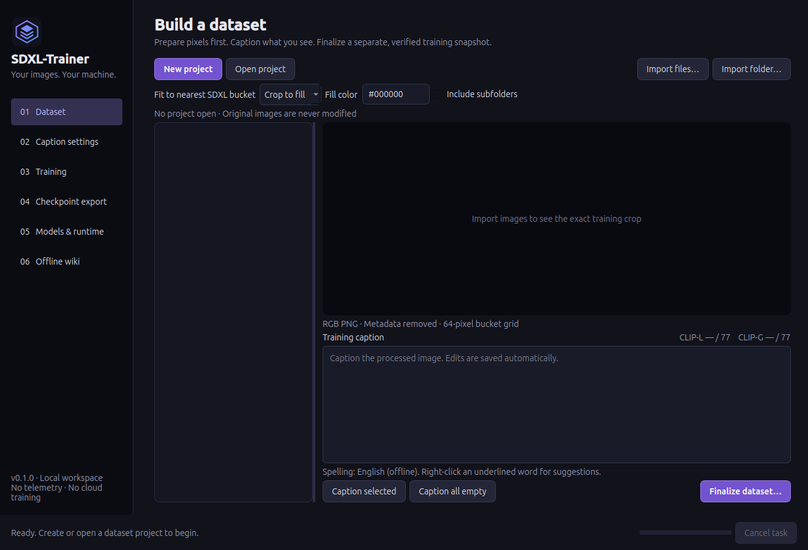

# SDXL-Trainer

A native dark desktop application for private SDXL dataset creation, GGUF vision captioning, LoRA training, and full fine-tuning. Designed for Ubuntu and one NVIDIA GPU, with a separate local PyTorch runtime. The UI uses purple, blue, charcoal, and black. No account, telemetry, cloud training, or remote inference.

The target system is Ubuntu 26.04.1 LTS with an NVIDIA RTX 5080 (16 GB VRAM) and 32 GB system RAM. Other configurations have not been validated.



**Status: 0.1.0 development build.** Dataset integrity, desktop workflows, downloader behavior, packaging, and tiny CPU training are tested. Real SDXL training on an RTX 5080, Qwen inference with the selected 9B weights, image quality, and 16 GB peak memory have **not** been validated on hardware. Joint VAE adaptation is experimental. This is a working implementation to validate, not a promise that every configuration fits or produces good weights.

## Workflow

1. **Models & runtime:** explicitly download your chosen models or select existing local files. Presets include HauhauCS Qwen3.5-9B Uncensored Aggressive Q8_0, LM Studio Community Qwen3.5-9B Q8_0, their matching vision projectors, and the official SDXL Base 1.0. Downloads use pinned revisions and verify hashes. Model weights are separate from the installer.
2. **Dataset:** create a project in an empty folder. Import files or a folder using native system dialogs. Originals remain untouched. Working copies are orientation-corrected, converted to sRGB when a valid ICC profile is present, stripped of metadata, converted to RGB PNG, and cropped or padded to a standard SDXL bucket. Crop to fill is the default.
3. **Caption:** caption the processed PNG with the managed local Qwen vision server. Edit the text, use offline spelling suggestions, and inspect both exact CLIP counts. Captions save automatically.
4. **Finalize:** choose a parent folder and enter a new folder name for the verified dataset snapshot. Existing destinations are never replaced. Empty captions, overlong captions, missing tokenizer assets, or modified pixels block finalization. Training consumes the snapshot, not the draft.
5. **Training:** choose LoRA or full training, select components, adjust controls, check the configuration, and start. Stop requests finish an optimizer update and save a resumable checkpoint.
6. **Export:** use the completed Diffusers pipeline directly, or convert it to a combined SDXL `.safetensors` checkpoint.

The in-app **Offline wiki** explains the controls and workflow in more detail. Its pages are also in [src/sdxl_trainer/wiki](src/sdxl_trainer/wiki).

## Install the Debian package

Builds are placed in `dist/sdxl-trainer_0.1.0_amd64.deb` with a SHA256 sidecar. Generated installers are ignored by Git and are not included in a fresh GitHub clone; build one using [the packaging guide](packaging/README.md), or use an installer supplied separately. From the repository folder on the target machine:

```bash
sudo apt install ./dist/sdxl-trainer_0.1.0_amd64.deb
```

Open **SDXL-Trainer** from the application menu. The package bundles a trimmed Qt desktop runtime and a pinned llama.cpp server with CUDA 12.8/cuBLAS libraries. System Python, standard desktop libraries, Pillow, and English spelling dictionaries are Debian dependencies. The NVIDIA driver must already work; the app does not replace drivers.

The included caption engine is llama.cpp **0.8.0 / b11960**, commit `8642541b255bfb5dc39cd351a178be09013a55d6`. Models are user-selected local data, not executable plugins. Engine upgrades require a deliberate package rebuild.

## Local training runtime

PyTorch is intentionally separate from the desktop installer. Use a Python environment supported by your chosen PyTorch CUDA build; select its `bin/python` in **Models & runtime → Local runtime**. For an RTX 5080, use an official Blackwell-capable CUDA build (CUDA 12.8 or later), then install the Python training dependencies. A typical setup, while online:

```bash
python3 -m venv /path/to/sdxl-runtime
/path/to/sdxl-runtime/bin/python -m pip install --upgrade pip
# Install the appropriate official PyTorch CUDA wheel for your Python and GPU.
/path/to/sdxl-runtime/bin/python -m pip install 'diffusers>=0.35,<0.40' 'transformers>=4.51,<6' 'peft>=0.17,<0.20' 'accelerate>=1.2,<2' 'safetensors>=0.5' 'numpy>=1.26' 'Pillow>=10'
```

Use the official [PyTorch installation selector](https://pytorch.org/get-started/locally/) for the torch command, rather than assuming a CUDA wheel is compatible with every Python version. **Inspect runtime** reports imports, CUDA availability, GPU name, and compiled architectures. For a fully offline target, transfer a prepared environment or compatible wheels and install with pip's `--no-index --find-links` options. The app does not download Python packages during training.

The app's ML loads use `local_files_only=True` and offline environment flags. Captioning binds an authenticated managed server to `127.0.0.1`; it never sends images to Hugging Face. Network activity is confined to explicit model-library actions.

## Development

```bash
python3 -m venv --system-site-packages .venv
.venv/bin/python -m pip install -e '.[test]'
.venv/bin/python -m sdxl_trainer
.venv/bin/python -m pytest
```

Headless GUI checks use `QT_QPA_PLATFORM=offscreen`. Training tests skip when optional ML dependencies are unavailable. The training worker can also run without Qt:

```bash
PYTHONPATH=src /path/to/sdxl-runtime/bin/python -m sdxl_trainer.training.worker --config recipe.json
PYTHONPATH=src /path/to/sdxl-runtime/bin/python -m sdxl_trainer.training.export --model_path /path/to/run/diffusers --output_path /path/to/model.safetensors
```

See [packaging/README.md](packaging/README.md) for verified runtime preparation and `.deb` builds. The build never includes your images, captions, downloaded model weights, credentials, or training outputs.

## Memory and quality

- Native SDXL uses two 77-token CLIP contexts including start/end tokens. This version rejects long captions rather than silently truncating or implementing unvalidated chunking.
- Trainable weights, gradients, and optimizer moments remain fp32. `bf16` controls eligible forward operations; VAE computation remains fp32.
- Disk AdamW spills gradients and optimizer state to disk without 8-bit quantization. This saves memory at a potentially severe speed and disk-space cost. An SSD is strongly recommended; all-component full training with two retained checkpoints has a conservative estimate around 176 GiB.
- Full SDXL UNet plus both text encoders and VAE can still exceed 16 GB VRAM or 32 GB RAM. Preflight estimates are lower bounds, not measurements or fit guarantees. CPU mode is available but can be extremely slow.
- VAE training uses a separate reconstruction, KL, and frozen-base latent-anchor objective. Diffusion gradients do not train the VAE. This reduces one source of latent-space drift but does not establish equal or improved image quality.
- No software can guarantee training quality. Review a small run, caption correctness, loss behavior, reconstructions, and fixed-prompt samples before spending time on a large job.

## Layout

```text
project/                    # editable working dataset
  project.json
  images/Img-1.png
         Img-1.txt
finalized-dataset/          # portable training snapshot
  manifest.json
  Img-1.png
  Img-1.txt
run/                       # worker-generated files only
  ... checkpoints, cache, optimizer state, adapters, Diffusers result
```

Project source paths stay in the private working manifest and are omitted from finalized snapshots. User settings live in `$XDG_CONFIG_HOME/sdxl-trainer` (normally `~/.config/sdxl-trainer`). Default model storage lives in `$XDG_DATA_HOME/sdxl-trainer/models`. Deleting a draft never alters imported originals.

## Repository hygiene

Keep original images, working datasets, finalized snapshots, model weights, credentials, and training outputs outside the source checkout. The root-level `models/`, `datasets/`, `projects/`, `runs/`, `outputs/`, and `checkpoints/` folders are ignored as an additional safeguard if used locally. Virtual environments, runtime downloads, installers, caches, editor settings, and common model-weight formats are also ignored.

A source backup contains the application, tests, wiki, package scripts, runtime lock, and license notices. It does not contain the large generated runtime, a prepared Python environment, installers, or model weights. Use the pinned packaging scripts to rebuild an installer; keep any installer backup separately from Git.

## License

The application source is licensed under the [MIT License](LICENSE). Bundled Qt, llama.cpp, and NVIDIA runtime components retain their own licenses; see [packaging/copyright](packaging/copyright) and [packaging/licenses](packaging/licenses). Model weights have their own upstream terms and are not included in this repository or installer.

## References

- [Diffusers SDXL training](https://huggingface.co/docs/diffusers/training/sdxl)
- [Official SDXL model](https://huggingface.co/stabilityai/stable-diffusion-xl-base-1.0)
- [Official Qwen3.5-9B model](https://huggingface.co/Qwen/Qwen3.5-9B)
- [llama.cpp multimodal input](https://github.com/ggml-org/llama.cpp/blob/master/docs/multimodal.md)
- [llama.cpp server API](https://github.com/ggml-org/llama.cpp/blob/master/tools/server/README.md)
- [NVIDIA CUDA architecture support](https://docs.nvidia.com/datacenter/tesla/drivers/cuda-toolkit-driver-and-architecture-matrix.html)
