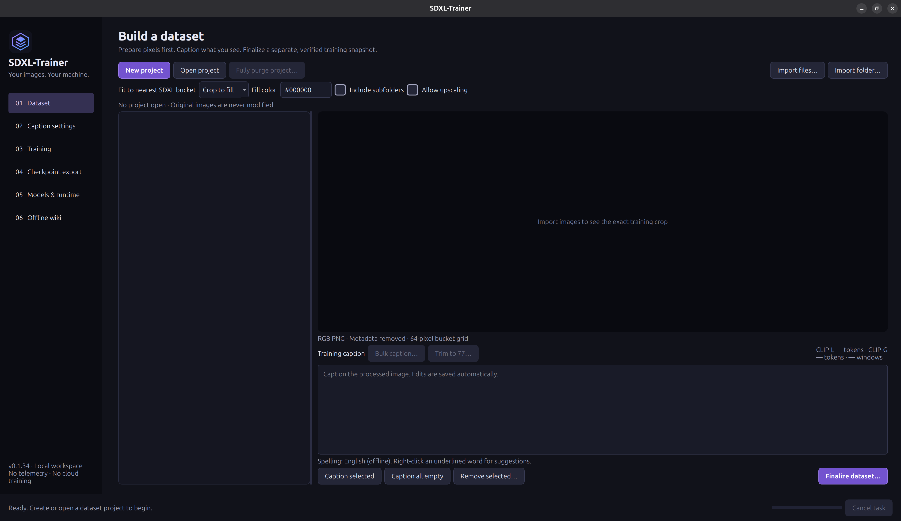

# SDXL-Trainer

A native dark desktop application for private SDXL dataset creation, GGUF vision captioning, LoRA training, and full fine-tuning. Designed for Ubuntu and one NVIDIA GPU, with a separate local PyTorch runtime. The UI uses purple, blue, charcoal, and black. No account, analytics, cloud training, or remote inference. Optional training performance and GPU readings stay local.

The target system is Ubuntu 26.04.1 LTS with an NVIDIA RTX 5080 (16 GB VRAM) and 32 GB system RAM. Other configurations have not been validated.



**Status: 0.1.34 development build.** The application starts with faster UNet-only training defaults for LoRA and full fine-tuning, while retaining all component, precision, caption-context, optimizer, and offload choices. Dataset integrity, desktop workflows, downloader behavior, packaging, and tiny SDXL training are tested. On the RTX 5080 Laptop GPU, the fast full-caption LoRA and full fine-tune paths each completed two distinct images, including 1,225-token and 905-token captions, saved checkpoints, and produced Diffusers outputs. These short checks do not establish long-run quality or memory fit for an entire dataset. See [VALIDATION.md](VALIDATION.md) for measured results and their limits. Full training with text encoders and VAE remains experimental on 16 GB; longer runs and output quality require validation.

## Workflow

1. In **Models & runtime**, download your chosen models or select existing local files. Presets include HauhauCS Qwen3.5-9B Uncensored Aggressive Q8_0, LM Studio Community Qwen3.5-9B Q8_0, their matching vision projectors, and the official SDXL Base 1.0 fp32 and fp16 Diffusers files. Downloads use pinned revisions and verify hashes. Model weights are separate from the installer. Use **Shared caption paths** to select the Qwen GGUF, vision projector, and llama.cpp server for new projects, then click **Save shared caption paths**.
2. **Dataset:** click **New project** and enter a readable name. Projects are created under `~/SDXL-Trainer/projects` by default. Import files or a folder using the matching dark file browser. Originals remain untouched. Working copies are orientation-corrected, converted to sRGB when a valid ICC profile is present, stripped of metadata, converted to RGB PNG, and cropped or padded to a standard SDXL bucket. Crop to fill is the default. Clear **Allow upscaling** to skip images whose pixels need enlargement for the selected fit. **Remove selected…** closes gaps in draft numbering and keeps surviving images paired with their captions.
3. Ctrl-click individual images or Shift-click a range, then click **Caption selected** to generate new captions for every highlighted image in draft order. This replaces any existing captions on those images. **Caption all empty** generates captions for blank entries. Both actions caption the processed PNGs with the managed local Qwen vision server. Every **New project** starts with the shared paths, built-in prompts and generation controls, and **Caption settings → Trim generated captions to 77 tokens** enabled. Uncheck it for longer captions. With a project open, click **Save caption settings** to save the whole form for that project, including any paths you selected for it. Edit the text, use offline spelling suggestions, and inspect both exact CLIP counts and the number of conditioning windows. Use **Bulk caption…** to replace, prepend, append, or fill empty captions for selected images or the whole draft. **Trim to 77…** checks both SDXL tokenizers and shortens overlong captions to fit a single window.
4. Click **Finalize dataset** to export each resolution as a separate verified dataset, such as `finalized/Dataset-1/Photo-Realistic:1024X1024`. Each folder contains its own manifest, PNGs, and full captions. Finalizing again creates the next numbered revision and keeps earlier exports available. Empty captions, unreviewed incomplete captions, missing tokenizer assets, or modified pixels block finalization.
5. Finalization selects the first bucket for training. In **Training → Files → Choose project dataset…**, pick a single bucket or **Dataset-N / All aspect ratios** for one run across that revision's buckets. Training reads the existing PNGs, captions, and manifests directly. To browse manually, select the revision folder for all its buckets or the folder containing `manifest.json` for an individual dataset. Older mixed-resolution snapshots also remain selectable. Choose LoRA or full training, review the fast defaults, check the configuration, and start. Frozen text and VAE caches are prepared before optimizer steps begin. Each method can use its own numbered output folder under `runs/` inside the project. Local phase timings and GPU utilization help identify bottlenecks. Stop requests finish an optimizer update and save a resumable checkpoint.
6. Use the standalone adapter from a completed LoRA run, load the complete Diffusers pipeline, or convert the pipeline to a combined SDXL `.safetensors` checkpoint. **Training → Files** sets the final Diffusers shard target, which defaults to 512 MiB. Smaller shards can reduce temporary saving memory at the cost of more files. A single tensor can exceed the target.

In **Caption settings**, click **Reset all caption settings** to restore both prompts and generation controls, turn on 77-token trimming, and save the open project's settings. The reset keeps the selected Qwen model, projector, and server paths. To apply the new default system prompt on its own, use **Reset system prompt**.

In **Training**, click **Save training settings** to store both training methods' settings and the selected method in the open project's `training-settings.json`. Switching projects, closing the app, or starting a run also saves the open project's training settings. To set the starting SDXL model and Diffusers file variant for new projects, use **Models & runtime → Local runtime → Save settings**.

Changing **Training method** restores that method's settings, including its learning rates, optimizer, step counts, output folder, and resume checkpoint. On first use, LoRA starts at a UNet learning rate of `1e-4` with fused AdamW. Full fine-tuning starts at `1e-6` with paged 8-bit AdamW and CUDA binary override `130`. Both methods share the project's model path, Diffusers file variant, and dataset path.

In **Training → Files**, choose a project run from **Saved runs**. Each entry includes its method and latest completed checkpoint step, such as **Run-2 · LoRA · Step 1,200**. Use **Resume checkpoint → Browse…** to open a run elsewhere. Selecting a run loads its saved training settings and shows its completed checkpoints in **Checkpoint step**, with the latest selected. Picking an older step suggests a new output folder when **Run output** points to the original run. Your own output choice stays in place when you change steps. Returning to the latest step restores the original run folder if the app's suggested output is still in use.

Click **Reset all training settings** beside **Save training settings**, then choose **LoRA defaults** or **Full fine-tune defaults**. This restores the chosen method's preset, keeps its output folder, clears its resume selection, and saves immediately to the open project.

The in-app **Offline wiki** explains the controls and workflow in more detail. Its pages are also in [src/sdxl_trainer/wiki](src/sdxl_trainer/wiki).

## Which LoRA file to use

Completed LoRA runs save both files in the run’s `adapters/` folder.

| File | Where to use it |
| --- | --- |
| `lora_comfyui.safetensors` | Artificial-It’s LoRA slot or ComfyUI’s **Load LoRA** node, with the SDXL base model. |
| `lora_diffusers.safetensors` | Diffusers `load_lora_weights`, with `weight_name="lora_diffusers.safetensors"`. |

The `pytorch_lora_weights.safetensors` entry is a compatibility alias for the same Diffusers weights. Both formats contain adapters for the UNet and any trained text encoders. Any trained VAE adapter is saved as a separate component file and merged into the model under `diffusers/`. Use that folder to load the full merged model. [Checkpoints and export](src/sdxl_trainer/wiki/07-checkpoints-and-export.md)

## Fast training defaults

New projects start with the LoRA performance defaults. **Fast training defaults** reapplies the performance selections for the current training method. It preserves model and dataset paths, learning rates, duration, seed, and captioning settings. With a project open, it saves the updated form to that project. With no project open, it updates the current form for a one-off run.

| Setting | Fast selection |
| --- | --- |
| Trainable components | UNet; both text encoders and VAE remain frozen |
| Full fine-tune optimizer | Paged AdamW with 8-bit moments; local CUDA binary override `130` |
| LoRA optimizer | Ordinary AdamW with fused GPU kernels when supported by placement |
| UNet/text weights and forward | BF16; LoRA adapters remain FP32 |
| VAE | FP32 |
| Caption context | Complete captions in multiple CLIP windows |
| Frozen caches | Prepared on GPU before trainable components are placed there |
| VAE sampling | One deterministic sampled latent per image |
| Cache RAM limits | Up to 4 GiB text and 1 GiB VAE; allocated only as used |
| Activations | Remain on GPU; gradient checkpointing remains enabled |
| TF32 | Allowed for BF16/FP16 forward; disabled for FP32 forward |

Full caption text, all conditioning windows, image resolution, and captioning prompts are preserved by these defaults. An optional **native** caption-context setting uses only the first 75 content tokens per CLIP during training; it must be selected explicitly and never edits the caption files. The fresh-latent posterior cache, FP32 weights and masters, CPU activation offload, trainable text encoders/VAE, and other optimizers remain available.

Fixed latent samples, BF16 weights, quantized optimizer moments, fused updates, and TF32 can change training numerics. Fast defaults are starting selections rather than a promise of equal quality or memory fit. Opening a large project also loads only visible list thumbnails instead of decoding every full image at startup.

## Install the Debian package

Builds are placed in `dist/sdxl-trainer_0.1.34_amd64.deb` with a SHA256 sidecar. Generated installers are ignored by Git and are not included in a fresh GitHub clone; build one using [the packaging guide](packaging/README.md), or use an installer supplied separately. From the repository folder on the target machine:

```bash
sudo apt install ./dist/sdxl-trainer_0.1.34_amd64.deb
```

Open **SDXL-Trainer** from the application menu. The package bundles a trimmed Qt desktop runtime and a pinned llama.cpp server with CUDA 12.8/cuBLAS libraries. System Python, standard desktop libraries, Pillow, and English spelling dictionaries are Debian dependencies. The NVIDIA driver must already work; the app does not replace drivers.

The included caption engine is llama.cpp **0.8.0 / b11960**, commit `8642541b255bfb5dc39cd351a178be09013a55d6`. Models are user-selected local data, not executable plugins. Engine upgrades require a deliberate package rebuild.

## Update an existing installation

Close SDXL-Trainer after any active download or training task has finished, then install the newer package:

```bash
cd ~/SDXL-Trainer
sudo apt install ./dist/sdxl-trainer_0.1.34_amd64.deb
```

APT upgrades the installed application. Model downloads remain in their existing library folder (normally `~/.local/share/sdxl-trainer/models`), and application settings remain in `~/.config/sdxl-trainer`. Previously saved application-wide caption paths appear under **Models & runtime → Shared caption paths**. For upgrades from releases before 0.1.20, the app brings previous application-wide caption preferences into the last-used project while keeping its project prompts. No model re-download or dataset migration is needed for this update.

On upgrade to 0.1.24, previously saved training settings carry over to the last-open project. The saved SDXL model path and Diffusers file variant become the shared starting choices for new projects.

## Local training runtime

PyTorch is intentionally separate from the desktop installer. Use a Python environment supported by your chosen PyTorch CUDA build; select its `bin/python` in **Models & runtime → Local runtime**. For an RTX 5080, use an official Blackwell-capable CUDA build (CUDA 12.8 or later), then install the Python training dependencies. A typical setup, while online:

```bash
python3 -m venv /path/to/sdxl-runtime
/path/to/sdxl-runtime/bin/python -m pip install --upgrade pip
# Install the appropriate official PyTorch CUDA wheel for your Python and GPU.
/path/to/sdxl-runtime/bin/python -m pip install 'diffusers>=0.35,<0.40' 'transformers>=4.51,<6' 'peft>=0.17,<0.20' 'accelerate>=1.2,<2' 'safetensors>=0.5' 'numpy>=1.26' 'Pillow>=10'
```

Use the official [PyTorch installation selector](https://pytorch.org/get-started/locally/) for the torch command, rather than assuming a CUDA wheel is compatible with every Python version. **Inspect runtime** reports imports, CUDA availability, GPU name, and compiled architectures. For a fully offline target, transfer a prepared environment or compatible wheels and install with pip's `--no-index --find-links` options. The app does not download Python packages during training.

The app's ML loads use `local_files_only=True` and offline environment flags. Captioning binds an authenticated managed server to `127.0.0.1`; it never sends images to Hugging Face. Network activity is confined to explicit model-library actions.

## Development

```bash
python3 -m venv --system-site-packages .venv
.venv/bin/python -m pip install -e '.[test]'
.venv/bin/python -m sdxl_trainer
.venv/bin/python -m pytest
```

Headless GUI checks use `QT_QPA_PLATFORM=offscreen`. Training tests skip when optional ML dependencies are unavailable. The training worker can also run without Qt:

```bash
PYTHONPATH=src /path/to/sdxl-runtime/bin/python -m sdxl_trainer.training.worker --config recipe.json
PYTHONPATH=src /path/to/sdxl-runtime/bin/python -m sdxl_trainer.training.export --model_path /path/to/run/diffusers --output_path /path/to/model.safetensors
```

See [packaging/README.md](packaging/README.md) for verified runtime preparation and `.deb` builds. The build never includes your images, captions, downloaded model weights, credentials, or training outputs.

## Memory and quality

- Each CLIP still has a native 77-token context. Long captions are split into 75-content-token windows and both encoders process every window; their penultimate states are concatenated for the UNet. CLIP-G pooled conditioning comes from the first window. This is chunked conditioning, not a longer CLIP context: text in one window cannot attend across windows. Inference programs must also support compatible long-prompt chunking to use long prompts similarly.
- Select UNet/text **weight precision** (`fp32`, `bf16`, or `fp16`) separately from the compatible **forward precision**. Fast defaults use BF16 weights and forward; the FP32 path remains available. With Disk AdamW, reduced-precision full training keeps fp32 optimizer master weights and moments on disk, with fp32 gradients in RAM or on disk, so small updates are not immediately lost; fp16 uses dynamic loss scaling and retries an overflowed batch. LoRA adapters remain fp32. The VAE defaults to fp32; bf16 and fp16 VAE computation are explicit experiments that can become unstable. File variant and compute precision are separate choices: loading an fp16 or bf16 VAE source as fp32 cannot recover precision already lost in that source.
- The tested SDXL Base VAE produced non-finite latents with fp16 VAE computation. Use the default fp32 VAE, evaluate bf16, or use a validated fp16-safe VAE in a compatible Diffusers pipeline. Verify stability and output quality for the chosen model and settings.
- Disk AdamW keeps fp32 moments in disk-backed files without 8-bit quantization. By default it uses RAM for accumulated gradients when available memory and swap meet its headroom checks, otherwise disk. For reduced-precision trainable weights with fp32 masters, the default update device is CPU; you can explicitly select CUDA to stream bounded fp32 master and moment updates when all trainable weights are on one GPU and enough VRAM is available. For fp32 trainable weights, auto may select GPU updates when feasible. Both choices are adjustable. These checks cannot guarantee that a run will fit: monitor RAM and swap, particularly when training the text encoders or VAE. Cache eviction depends on the operating system. Disk-backed pages can use RAM and be reclaimed under pressure; heavy RAM, swap, or disk activity can still make training slow. An SSD is strongly recommended; all-component full training with two retained checkpoints has a conservative estimate around 176 GiB. Resumable component weights are written in bounded chunks using standard Safetensors files to reduce checkpoint-time RAM peaks. Existing checkpoints retain their saved update backend when resumed; older checkpoints retain their original CPU backend. CPU and GPU fp32 arithmetic can differ slightly in rounding.
- **Paged AdamW · 8-bit moments (direct weights)** is the fast full-training choice. It quantizes optimizer moments and has no fp32 master weights for reduced-precision full training, so bf16/fp16 gradients and small updates can round or underflow. All trainable components must be on one GPU; CPU-offloaded trainable components and staged VAE training are unsupported. CUDA paging can use system RAM and swap, while model weights and gradients still need GPU memory. Fast LoRA instead selects ordinary AdamW with optional fused GPU kernels. Disk AdamW remains available for fp32 moments/masters and memory-oriented offloading. See [Memory and optimizer](src/sdxl_trainer/wiki/06-memory-and-optimizer.md) for runtime and resume requirements.
- A two-image full UNet test on the RTX 5080 took 16.0 and 16.4 seconds per step with paged 8-bit AdamW, versus 72.1 and 87.1 seconds with fp32-master Disk AdamW. Sampled GPU use reached 15,832 MiB and 6,320 MiB respectively; a repeat of the 8-bit run also sampled about 2.2 GiB of worker swap during saving. The optimizers differ numerically, and these short tests do not establish visual quality or long-run stability.
- Disk AdamW RAM-gradient admission reserves additional space when fp32 masters are needed. A reduced-precision full UNet alone requires roughly 31 GiB of *available* RAM, so a 32 GB computer will typically use disk gradients. After a completed update, the app releases any RAM-gradient buffer before checkpointing and checks headroom again before allocating it for the next backward pass. If memory is insufficient, resume the completed checkpoint with disk gradient storage. These measures reduce memory pressure but do not eliminate swap or out-of-memory risk.
- **Training → Memory → Component offload** can place the text encoders on CPU, optionally place the VAE on CPU, or temporarily park the UNet in disk-backed CPU memory during GPU VAE work while keeping the text encoders on CPU or GPU. Staged UNet with VAE training requires Disk AdamW and uses disk gradients when storage is `auto`. An unchanged staged UNet snapshot is reused until the next optimizer update, avoiding redundant writes. Staging reserves roughly 10 GiB of additional temporary disk space for fp32 UNet weights, or roughly half for 16-bit weights, released when the training worker exits; disk pages may also use RAM. Mixed-device Disk AdamW updates on CPU. Offloading retains the selected weight precision, full resolution, and the existing VAE objective, but reduced-precision arithmetic changes numerical behavior and no quality or fit is guaranteed. Monitor available RAM, swap, and VRAM: these choices can be very slow, and the monitor does not automatically stop a memory-heavy run. Keep the same placement when resuming.
- **Trainable CPU text precision** defaults to `match`, using the selected model weight precision. With both text encoders enabled and placed on CPU, choose `fp32` to load and run them in fp32 while retaining the chosen UNet precision. Compared with 16-bit text weights this can add about 1.5 GiB of system RAM. It can change mixed-precision conditioning and training results; speed and memory fit are not guaranteed. FP32 loading cannot recover precision already rounded in fp16 or bf16 source files. Keep the same option when resuming.
- Frozen caches are prepared on GPU before trainable components are placed there, then read from bounded CPU RAM or validated local files. The default **sample** VAE mode reuses one deterministic sampled latent per image; **posterior** retains fp32 means/log-variances and draws a fresh latent each visit. Posterior caching requires FP32 VAE computation; sample caching checks the selected VAE precision. Training a component bypasses its frozen cache. RAM limits default to 4 GiB for text and 1 GiB for VAE entries, allocated as used; zero disables that RAM layer. Caches never replace original image or caption files.
- Optional phase timings include CPU wall intervals and CUDA stream elapsed intervals, which can overlap and can include idle time. GPU utilization and VRAM are sampled locally for the selected device as totals for the whole GPU, not just this process. The monitor also reports host-wide available RAM and swap and, when available, the training worker's swap usage. See the offline wiki for interpretation.
- Full SDXL UNet plus both text encoders and VAE can still exceed 16 GB VRAM or 32 GB RAM. Preflight estimates are lower bounds, not measurements or fit guarantees. CPU mode is available but can be extremely slow.
- VAE training uses a separate reconstruction, KL, and frozen-base latent-anchor objective. Diffusion gradients do not train the VAE. This reduces one source of latent-space drift but does not establish equal or improved image quality.
- No software can guarantee training quality. Review a small run, caption correctness, loss behavior, reconstructions, and fixed-prompt samples before spending time on a large job.

## Layout

```text
Photo-Realistic/            # editable working dataset and its generated work
  project.json
  caption-prompts.json     # project-specific editable prompts
  images/Img-1.png
         Img-1.txt
  finalized/Dataset-1/      # one export revision
    Photo-Realistic:832X1216/
      manifest.json
      Img-1.png
      Img-1.txt
    Photo-Realistic:1024X1024/
      manifest.json
      Img-2.png
      Img-2.txt
  runs/Run-1/               # checkpoints, cache, optimizer state, model output
  logs/launches/            # training launch records
```

Project source paths stay in the private working manifest and are omitted from finalized snapshots. User settings live in `$XDG_CONFIG_HOME/sdxl-trainer` (normally `~/.config/sdxl-trainer`). Default model storage lives in `$XDG_DATA_HOME/sdxl-trainer/models`.

## Purge a project

Open the project and choose **Fully purge project…**. Review the folder and its contents, then type the project name to confirm. This permanently deletes everything inside the project folder: the working dataset, finalized snapshots, project-contained runs, checkpoints, outputs, and logs. The displayed training log is also cleared. Purge cannot be undone.

Original images, shared model files, and other files outside that folder remain untouched. Files you deliberately placed *inside* the folder are included in the purge. Older outputs saved elsewhere are not tracked or deleted; review and remove them separately if you no longer need them. Keep anything you want to retain outside the project before purging.

## Repository hygiene

New projects default to `~/SDXL-Trainer/projects/<project name>`; the `projects/` folder is ignored by Git. Change the parent folder under **Models & runtime → Local runtime → Projects folder** if desired. Keep original images, model weights, credentials, and other training outputs outside the source checkout or in the ignored local-data folders. The root-level `models/`, `datasets/`, `projects/`, `runs/`, `outputs/`, and `checkpoints/` folders, generated image/caption pairs and project manifests, nested finalized datasets, runs and logs, virtual environments, runtime downloads, installers, editor settings, and common model-weight formats are ignored.

Ignore rules reduce accidental additions; they do not remove files already tracked or protect files added with Git's force option. Check the files staged in VS Code before publishing. In particular, keep custom project folders and originals outside the checkout or under its ignored data folders.

A source backup contains the application, tests, wiki, package scripts, runtime lock, and license notices. It does not contain the large generated runtime, a prepared Python environment, installers, or model weights. Use the pinned packaging scripts to rebuild an installer; keep any installer backup separately from Git.

## License

The application source is licensed under the [MIT License](LICENSE). Bundled Qt, llama.cpp, and NVIDIA runtime components retain their own licenses; see [packaging/copyright](packaging/copyright) and [packaging/licenses](packaging/licenses). Model weights have their own upstream terms and are not included in this repository or installer.

## References

- [Diffusers SDXL training](https://huggingface.co/docs/diffusers/training/sdxl)
- [Official SDXL model](https://huggingface.co/stabilityai/stable-diffusion-xl-base-1.0)
- [Official Qwen3.5-9B model](https://huggingface.co/Qwen/Qwen3.5-9B)
- [llama.cpp multimodal input](https://github.com/ggml-org/llama.cpp/blob/master/docs/multimodal.md)
- [llama.cpp server API](https://github.com/ggml-org/llama.cpp/blob/master/tools/server/README.md)
- [NVIDIA CUDA architecture support](https://docs.nvidia.com/datacenter/tesla/drivers/cuda-toolkit-driver-and-architecture-matrix.html)
